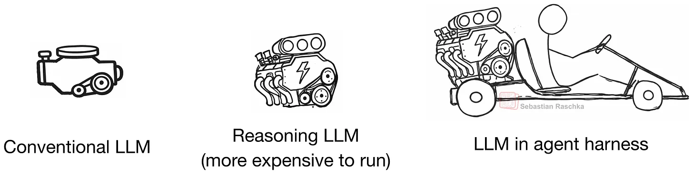
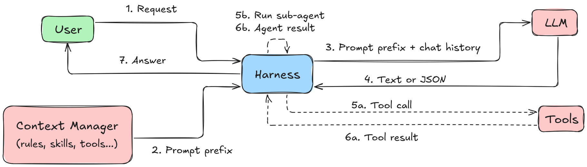
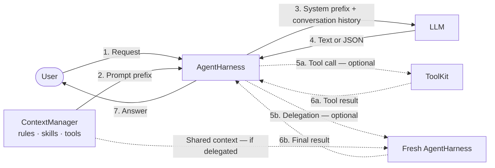
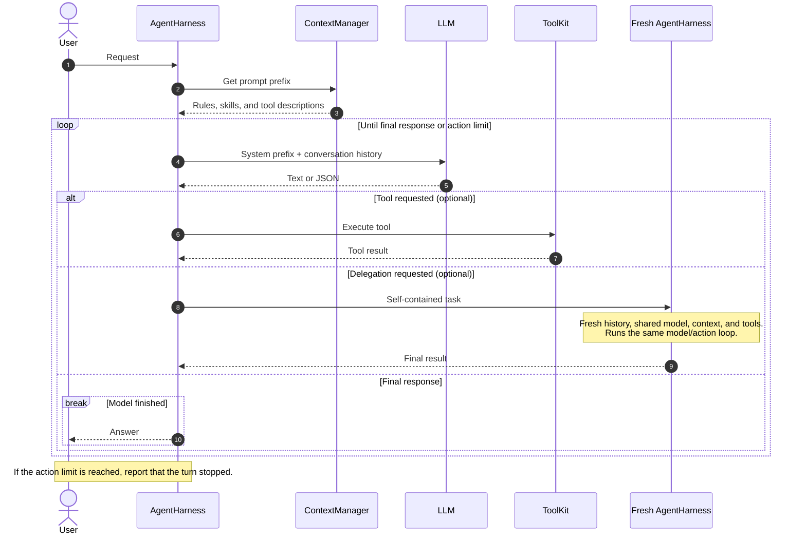
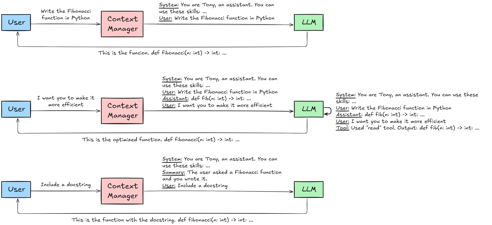

# Agent Harness

A small, readable coding-agent harness built from scratch in Python. It keeps
the orchestration visible: the Groq adapter converts native function calls into
JSON, the harness executes tools or delegates work, and the result goes back into
the conversation. Ordinary text responses and plain JSON requests are also supported.

The project is intentionally minimal. It is a useful base for learning how an
agent loop works without hiding the important parts behind a large framework.



Illustration credit: Sebastián Raschka.

## Features

- A simple model → action → result loop
- Project instructions loaded from `data/AGENTS.md`
- Skill summaries discovered from Markdown files in `data/skills/`
- Three built-in tools: read a file, write a file, and run a shell command
- Confirmation before shell commands outside a configurable safe list
- Fresh subagents with access to the same project context and tools
- Local commands for help, history compaction, reset, and exit
- A configurable per-turn model-call limit
- Tests mock model calls and never contact the real model; tool tests also
  exercise real file operations and shell commands

## How it works

### Flow overview





Dashed arrows mark optional paths. After a tool or subagent returns a result
(step 6a or 6b), the harness repeats from step 3 until the model answers or the
action limit is reached. A direct answer skips steps 5 and 6.

### Message sequence



Numbers show message order. Tool execution and delegation are optional branches;
their results are added to the conversation before the next model call. Dashed
arrows indicate responses. A direct answer skips both optional branches.

Conversation history stores only conversation messages. Each agent model request
prepends the prompt prefix once as a system message, without storing it in
history. After `/compact` or `/reset`, the next turn still receives the prefix.



This is a conceptual view: `AgentHarness` assembles the model requests and records
results, while `ContextManager` builds the system prefix. Compaction happens only
when the user runs `/compact`.

The Groq adapter registers native functions for the three tools and delegation,
then converts native calls into the JSON formats below. The harness also accepts
these formats directly as assistant text. Delegation remains separate from
`ToolKit`.

A tool request uses this internal format:

```json
{"tool": "read_file", "arguments": {"path": "README.md"}}
```

Delegation uses a separate format:

```json
{"delegate": "Inspect the tests and summarize the missing coverage."}
```

A subagent starts with fresh history, shares the parent's model, project
context, and tools, and returns only its final response to the parent. Subagents
may delegate again.

## Setup

Prerequisites: Python 3.12 or newer, `uv`, and `make`. The shell examples assume
a POSIX environment, such as Linux or macOS.

From the project root, install the dependencies:

```bash
make install
```

Create a `.env` file in the project root:

```dotenv
GROQ_API_KEY=your-api-key
```

Then start the harness:

```bash
uv run python -m src.main
```

The default model and other settings live in `src/config.py`.

## Example session

This short example exercises the three built-in tools, shell approval,
subagents, and conversation commands. Enter each query on one line. Model
responses may vary, but the workflow should remain the same.

### 1. Inspect the local commands

At the `You >` prompt, enter:

```text
/help
```

### 2. Build and run a Fibonacci program

```text
Create fibonacci.py with an iterative fibonacci(n) function, using F(0) = 0 and F(1) = 1. Add a small CLI that reads n from the command line and rejects negative values. Read the completed file back, execute .venv/bin/python fibonacci.py 14, and report the result. Keep it dependency-free and minimal.
```

The project rules require the agent to describe its approach before editing.
When it asks for approval, enter `yes` as a new query.

The agent should use `write_file`, `read_file`, and `shell`. Because the Python
command is not in the safe-command list, the harness will ask for permission
before running it. With the indexing defined above, the expected result is
`377`.

### 3. Delegate a review

```text
Delegate a review of fibonacci.py to a subagent. Ask it to check correctness and edge cases. Apply only necessary fixes, run the program again for n = 14, and summarize the review.
```

The subagent receives fresh conversation history while sharing the same project
files, context, model, and tools. Its final response is returned to the parent,
which can continue working.

### 4. Try the history commands

Enter these queries one at a time:

```text
/compact
What did we implement, and what was F(14)?
/reset
/exit
```

`/compact` replaces the history with a model-generated summary, while `/reset`
clears it completely.

## Commands

Slash commands are dispatched locally. `/compact` makes a model request to
summarize the history; the other commands do not call the model.

| Command | Action |
| --- | --- |
| `/help` | Show the available commands |
| `/compact` | Replace the current history with a model-generated summary |
| `/reset` | Clear the conversation history |
| `/exit` | Exit the harness |

## Tools

| Tool | Purpose |
| --- | --- |
| `read_file` | Read a UTF-8 file |
| `write_file` | Create or overwrite a UTF-8 file |
| `shell` | Run a shell command and return its exit code, stdout, and stderr |

`ShellTool` compares the complete command string against
`config.tools.safe_shell_commands`. An exact match runs immediately; every
other command asks the user for confirmation.

> [!WARNING]
> This is a learning project, not a security boundary. Shell commands run with
> the current user's permissions and are not sandboxed. The file tools also do
> not confine paths to the project directory.

## Project structure

```text
agent-harness/
├── data/
│   ├── AGENTS.md          # Project instructions given to the model
│   └── skills/            # Markdown skill descriptions
├── src/
│   ├── config.py          # Prompts and runtime configuration
│   ├── context_manager.py # Builds the project-aware prompt prefix
│   ├── harness.py         # Commands, agent loop, tools, and delegation
│   ├── llm.py             # Groq adapter
│   ├── main.py            # Application wiring and entry point
│   └── tools.py           # Tool definitions and dispatch
└── tests/                 # Unit tests using mocked model responses
```

## Current limitations

- Model integration is Groq-specific. Native tool and delegation calls are
  converted to internal JSON; provider call IDs and native tool-result messages
  are not preserved in conversation history.
- Tool exceptions, provider errors, and malformed native call arguments can
  terminate the session. Nonzero shell exit codes are returned to the model as
  feedback.
- Each agent model call resends one system prefix and the entire conversation
  history. Token usage still grows throughout a session and can exceed rate or
  context limits; compaction is manual.
- Conversation history exists only in memory.
- History compaction depends on the model returning a useful summary.
- Each subagent gets a fresh model-call budget, so recursive delegation has no
  global depth or cost limit.
- File writes overwrite existing content and are not transactional.

## Possible extensions

- Add token-aware context management or automatic compaction.
- Validate action arguments, return tool exceptions to the model for recovery,
  and report provider failures without terminating the CLI.
- Give subagents a shared global budget, depth limit, cancellation, or parallel
  execution.
- Add a sandbox and restrict file access to the project root.
- Add a project-tree tool so the model can inspect the repository efficiently.
- Let the agent maintain a small todo list for longer tasks.
- Introduce a provider-neutral model interface with additional LLM adapters.
- Persist conversations and resume previous sessions.
- Preserve native call IDs and tool-result messages throughout the conversation.
- Stream model responses and expose progress for long-running actions.
- Add richer approval policies per tool, path, or command.

## License

This project is available under the [MIT License](LICENSE).
