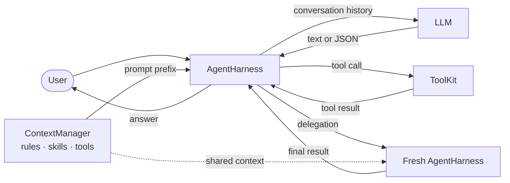

# Agent Harness

A small, readable coding-agent harness built from scratch in Python. It keeps
the orchestration visible: the model replies with plain text or JSON, the
harness executes tools or delegates work, and the result goes back into the
conversation.

The project is intentionally minimal. It is a useful base for learning how an
agent loop works without hiding the important parts behind a large framework.

## Features

- A simple model → action → result loop
- Project instructions loaded from `data/AGENTS.md`
- Skill summaries discovered from Markdown files in `data/skills/`
- Three built-in tools: read a file, write a file, and run a shell command
- Confirmation before shell commands outside a configurable safe list
- Fresh subagents with access to the same project context and tools
- Local commands for help, history compaction, reset, and exit
- A configurable per-turn action limit
- A fully mocked test suite—tests never call the real model

## How it works



The model can answer normally or request one action using plain JSON:

```json
{"tool": "read_file", "arguments": {"path": "README.md"}}
```

Delegation uses a separate format:

```json
{"delegate": "Inspect the tests and summarize the missing coverage."}
```

A subagent starts with fresh history, shares the parent's model, project
context, and tools, and returns only its final response to the parent. Subagents
may delegate again.

## Requirements

- Python 3.12 or newer
- [uv](https://docs.astral.sh/uv/)
- A Groq API key

## Setup

Install the dependencies:

```bash
make install
```

Create a `.env` file in the project root:

```dotenv
GROQ_API_KEY=your-api-key
```

Then start the harness:

```bash
uv run python -m src.main
```

The default model and other settings live in `src/config.py`.

## Example session

This short example exercises the three built-in tools, shell approval,
subagents, and conversation commands. Model responses may vary, but the
workflow should remain the same.

### 1. Inspect the local commands

At the `User query:` prompt, enter:

```text
/help
```

### 2. Build and run a Fibonacci program

```text
Create fibonacci.py with an iterative fibonacci(n) function, using F(0) = 0
and F(1) = 1. Add a small CLI that reads n from the command line and rejects
negative values. Read the completed file back, execute
.venv/bin/python fibonacci.py 14, and report the result. Keep it
dependency-free and minimal.
```

The agent should use `write_file`, `read_file`, and `shell`. Because the Python
command is not in the safe-command list, the harness will ask for permission
before running it. With the indexing defined above, the expected result is
`377`.

### 3. Delegate a review

```text
Delegate a review of fibonacci.py to a subagent. Ask it to check correctness
and edge cases. Apply only necessary fixes, run the program again for n = 14,
and summarize the review.
```

The subagent receives fresh conversation history while sharing the same project
files, context, model, and tools. Its final response is returned to the parent,
which can continue working.

### 4. Try the history commands

```text
/compact
What did we implement, and what was F(14)?
/reset
/exit
```

`/compact` replaces the history with a model-generated summary, while `/reset`
clears it completely.

## Commands

Commands are handled locally and are not sent to the model.

| Command | Action |
| --- | --- |
| `/help` | Show the available commands |
| `/compact` | Replace the current history with a model-generated summary |
| `/reset` | Clear the conversation history |
| `/exit` | Exit the harness |

## Tools

| Tool | Purpose |
| --- | --- |
| `read_file` | Read a UTF-8 file |
| `write_file` | Create or overwrite a UTF-8 file |
| `shell` | Run a shell command and return its exit code, stdout, and stderr |

`ShellTool` compares the complete command string against
`config.tools.safe_shell_commands`. An exact match runs immediately; every
other command asks the user for confirmation.

> [!WARNING]
> This is a learning project, not a security boundary. Shell commands run with
> the current user's permissions and are not sandboxed. The file tools also do
> not confine paths to the project directory.

## Project structure

```text
agent-harness/
├── data/
│   ├── AGENTS.md          # Project instructions given to the model
│   └── skills/            # Markdown skill descriptions
├── src/
│   ├── config.py          # Prompts and runtime configuration
│   ├── context_manager.py # Builds the project-aware prompt prefix
│   ├── harness.py         # Commands, agent loop, tools, and delegation
│   ├── llm.py             # Groq adapter
│   ├── main.py            # Application wiring and entry point
│   └── tools.py           # Tool definitions and dispatch
└── tests/                 # Unit tests using mocked model responses
```

## Development

```bash
make test    # Run tests with coverage
make lint    # Run all static checks
make check   # Run lint and tests
make format  # Format source and tests
```

## Current limitations

- Tool and delegation requests are parsed from plain model-generated JSON.
- Tool errors propagate instead of being converted into model feedback.
- Conversation history exists only in memory.
- History compaction depends on the model returning a useful summary.
- Each subagent gets a fresh action budget, so recursive delegation has no
  global depth or cost limit.
- File writes overwrite existing content and are not transactional.

## Possible extensions

- Add a sandbox and restrict file access to the project root.
- Add a project-tree tool so the model can inspect the repository efficiently.
- Let the agent maintain a small todo list for longer tasks.
- Introduce a provider-neutral model interface with additional LLM adapters.
- Persist conversations and resume previous sessions.
- Give subagents a shared global budget, depth limit, cancellation, or parallel
  execution.
- Validate tool arguments and return execution errors to the model for recovery.
- Replace the text JSON protocol with provider-native structured tool calls.
- Stream model responses and expose progress for long-running actions.
- Add richer approval policies per tool, path, or command.

## License

This project is available under the [MIT License](LICENSE).
